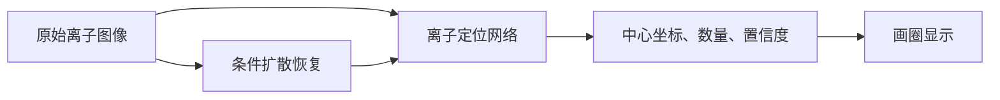

# 大晶格离子识别与 Diffusion 研究讨论记录

日期：2026 年 11 月 3 日（Asia/Hong_Kong）

项目目录：`F:\CQI\Bell Camera\Net Recog`

代码仓库：[xiaoshecode/iondetection](https://github.com/xiaoshecode/iondetection)

> 本文件保存本次讨论中的用户提问、实验条件补充和助手正式答复。正文内容保留，公式分隔符适配 GitHub Markdown。文中的本地文件链接仅在对应电脑上可用；这些被引用文件不包含在本次提交中。论文发表状态及检索判断以讨论日期为准。

## 一、研究需求、相关工作与创新方案

### 用户提问

读“IOn CV recog”本地对话，你会知道我在干什么，我想做一个离子识别的工作，但是现在想做一个在pc上跑的工作，暂时不用放到FPGA上。我打算去采1w张大晶格的离子的图像，现在的数据集都是小晶格的图像，图像边缘的离子并不会有特别严重的拖尾，雾化或者说micromotion，我想做的工作就是能够准确识别离子，教会模型怎么准确画圈框出离子，想做一个先分割区域，然后在区域内找最亮点画圈标离子，类似于Fast RCNN？首先需要你调研一下有没有类似的相关工作，其次，有没有什么能做的创新的方案。计划投一下CVPR这种，主要是想讲一下离子阱量子计算的故事，加上图像处理。

### 助手补充询问

为判断采集和标注方案是否可行，请补充：计划的大晶格每张约有多少个离子，是单层二维还是多层三维投影？同一晶格能否重复拍摄，并采到较清楚的参考图？

### 用户补充

二维晶格，每张几百个到一千个；能重复拍摄，但是我会想拍更多不一样的情况

### 助手答复

我读了 **“Ion CV Recog”**，也检查了你现有的图像和识别代码。结合你补充的条件——**二维晶格，每张数百到一千个离子，可以重复拍摄，并计划覆盖更多不同情况**——这个方向值得做。

但需要先明确一个判断：**“用分割或 Faster R-CNN 找离子，再画圈”已经有非常接近的工作；要冲 CVPR，核心贡献需要落在大晶格带来的定位困难，以及解决这些困难的新方法上。**量子计算背景可以解释问题为什么重要，但不能替代视觉方法的贡献。

**最接近你的想法的论文，已经直接使用了 Faster R-CNN。**下面是这次检索中最值得优先读的几项；截至 2026 年 11 月 3 日，这是一轮针对性调研，尚不能据此声称某个方向完全无人做过。

| 工作 | 已经做了什么 | 对你意味着什么 |
|---|---|---|
| **Wolf 等，Efficient site-resolved imaging and spin-state detection in dynamic two-dimensional ion crystals，Physical Review Applied，2024** | 对百余个离子的二维 Penning 晶格做运动校正，再用 **Faster R-CNN 定位**；用二维高斯拟合比较定位结果，也分析了外围光斑的椭圆展宽。 | **最直接的先例。**“大晶格＋神经网络定位＋边缘模糊”已有；其光子时间戳相机、旋转校正，与普通相机下的 Paul 阱微运动有区别。[论文](https://arxiv.org/abs/2303.10801) |
| **Allsopp 等，Convolutional neural network approach to ion Coulomb crystal image analysis，J. Chemical Physics，2025** | 用大量模拟图训练 ResNet50，估计整个晶体的离子数，并验证两个实验室的真实图像。 | 是**总数估计**，不是逐离子准确定位；但物理模拟训练、跨实验室验证也已有先例。[论文](https://arxiv.org/abs/2503.18846) |
| **DECODE，Deep learning enables fast and dense single-molecule localization with high accuracy，Nature Methods，2021** | 从密集荧光图中预测检出概率、亚像素坐标、亮度和不确定性。 | 你的问题与**单分子定位显微成像**非常接近，应把它作为强基线。[论文](https://www.nature.com/articles/s41592-021-01236-x) |
| **FD-DeepLoc，Field-dependent deep learning enables high-throughput whole-cell 3D super-resolution imaging，Nature Methods，2023** | 处理大视场中随位置变化的点扩散函数，即不同位置的光斑形状不同。 | “中央清楚、边缘模糊，所以加入位置编码”本身不足以构成新意。[论文](https://www.nature.com/articles/s41592-023-01775-5) |
| **LUNAR，Aberration-aware 3D localization microscopy via self-supervised neural-physics learning，Nature Communications，2026** | 从未标注、存在重叠的原始荧光数据中，联合学习物理成像模型与定位网络。 | **最需要警惕的创新重合。**物理模型、重建约束、自监督、未知像差和密集定位的组合已有强工作。[论文](https://www.nature.com/articles/s41467-026-73045-9) |
| **P2PNet，Rethinking Counting and Localization in Crowds: A Purely Point-Based Framework，ICCV，2021** | 直接预测目标点集合，用一对一匹配训练定位和计数。 | 可以直接学习离子中心，不必先把任务强制改成矩形框检测。[论文](https://openaccess.thecvf.com/content/ICCV2021/papers/Song_Rethinking_Counting_and_Localization_in_Crowds_A_Purely_Point-Based_Framework_ICCV_2021_paper.pdf) |
| **Zhukas 等，Direct observation of ion micromotion in a linear Paul trap，Physical Review A，2021** | 用时间分辨单光子相机测量多个离子的微运动幅度和相位。 | 为微运动模型和独立参考测量提供依据，也说明普通长曝光图不能自动提供同等的运动信息。[论文](https://arxiv.org/abs/2010.00159) |

Wolf 那篇特别值得注意：它把**位置检测**和**量子态读出**分开评价，不能将读出保真度当成“所有离子都找对”的准确率。你将来也需要这样区分。

**你的“先分区域，再在区域内找最亮点”可以做基线，但建议修改第二步。**严格说，它更接近“分割辅助的点定位”；Fast R-CNN 的核心是对候选区域进行分类和框回归，并不等同于分割后寻峰。[Fast R-CNN 原论文](https://arxiv.org/abs/1504.08083)

而且，你自己的 [CVIONS.py](<F:/CQI/Bell Camera/Recog/CCD-Recognition/single_scan_images/CVIONS.py:159>) 已经有一个接近的经典流程：LoG 滤波、阈值分割、连通域、强度加权质心；另一条流程则用最亮点初始化高斯拟合。因此，现有代码正好可以当起点。

问题在于，**画圈只是显示结果，真正要学习的是“有几个离子、各自在哪里”。**

- 一个离子的运动光斑可能出现两个峰，导致重复计数。
- 两个相邻离子的光斑可能连成一个区域，导致漏检。
- 噪声、非对称像差和邻居串扰可能让最亮像素偏离中心。
- 模糊区域可能根本没有足够信息唯一确定答案，模型需要表达不确定性。

其中，“最亮点不等于运动中心”是根据成像模型作出的判断。例如，理想正弦运动在转折位置停留更久，时间积分后可能出现双峰；实际形状还取决于光学成像和随运动变化的荧光强度。

因此，标签必须先定义清楚：你希望圈住的是**荧光峰值、光斑质心，还是离子的平均／平衡位置**。对量子控制和位置标定，我更倾向于后者；若目标只是选取读出区域，则还需要评价区域内收光和邻居串扰。

**我最推荐的研究问题是：在空间变化的运动模糊和光斑重叠下，如何可靠恢复密集点源的数量与中心。**离子阱提供真实、可调控的实验场景。下面三个方向可以围绕这个问题展开，但都属于待验证的研究假设。

| 方向 | 具体要解决的问题 | 我的判断 |
|---|---|---|
| **运动与光学模糊分开建模的定位** | 区分“一颗离子拖成双峰”和“两颗离子靠得很近”，联合估计中心、亮度及有效运动展宽。 | **最适合作为主线。**关键是证明能处理普通定位器无法区分的情况，而不只是加入一个物理损失。 |
| **允许缺陷和边界变化的晶格辅助定位** | 借助邻居关系纠正漏检、重复计数，同时避免在边界外或真实缺陷处强行补点。 | 很符合你已经遇到的问题；建议先作为主线的一个模块。单纯加 GNN 不够。 |
| **带独立参考的大晶格困难数据集** | 系统覆盖离子数量、重叠程度、光子数、模糊和不同实验条件，揭示已有方法的失败边界。 | 这是你的实验优势。价值取决于多样性、标签可信度和评测设计，不能只靠“1 万张”。 |

这里也要防止一个误区：**晶格先验不是越强越好。**已有研究已经使用晶格结构改善荧光定位，因此“加入晶格约束”本身也不是空白。你的机会是处理离子晶格中的非均匀间距、边界、缺陷和重排，并证明模型不会按理想晶格臆造离子。[相关晶格先验工作](https://www.nature.com/articles/s41467-025-64083-w)

在 PC 上，我会保留你的两阶段思路，把它具体化为：

1. **全图寻找候选区域和粗中心。**用保留细节的网络产生中心热图及软区域，区域内允许有多个离子。
2. **对相互重叠的候选联合分析。**比较“一个展宽离子”和“多个邻近离子”等解释，输出离子数、亚像素中心、亮度和不确定性。
3. **用成像模型检查解释是否合理。**把预测的离子重新生成图像，与原始观测比较；加入较弱的邻接约束，限制重复点和无依据补点。
4. **最后生成圆圈或读出区域。**圆圈显示中心；光斑覆盖范围和中心误差应分别表达，不能把它们混成一个“半径”。

其中一个简化成像表达是：

$$
I(\mathbf u)\approx b(\mathbf u)+
\sum_{i=1}^{N}a_i
\left[h_{\mathrm{opt},i}*k_{\mathrm{motion},i}\right]
(\mathbf u-\mathbf c_i)
+\text{相机噪声}.
$$

这里，$\mathbf c_i$ 是中心，$h_{\mathrm{opt},i}$ 是光学点扩散函数，$k_{\mathrm{motion},i}$ 是曝光期间运动造成的展宽。**这个公式本身不是创新**；难点是从混叠图像中可靠区分这些因素，并给出可检验的结果。

也不能直接把所有拖尾称为 micromotion。离焦、像差、慢漂移等都可能造成相似外观。若没有独立标定，先研究“有效模糊下的定位”更稳妥；若能证明运动成分及其规律，再主张微运动感知定位。尤其不能仅凭单幅长曝光图就承诺恢复真实运动相位。

**你准备采集更多不同情况，这比单纯增加连拍帧数更重要。**现有目录有 931 张原始 PNG、35 个采集批次，但尚没有完整的逐离子真值。这些图适合启动基线和分析错误，暂时不足以证明识别准确率。

我建议新数据兼顾“广泛变化”和“少量可靠重复”：

| 采集部分 | 应该覆盖什么 | 用途 |
|---|---|---|
| 不同晶格 | 数百至上千离子、不同构型和间距、重新装载、不同日期 | 检验是否记住了固定排列 |
| 不同成像条件 | 曝光、光强、增益、焦点、背景及实际可控的退化条件 | 检验模糊与低信噪鲁棒性 |
| 同一晶格的成组拍摄 | 重复帧、可靠参考帧、条件变化前后的记录 | 建立标签、估计稳定性和漂移 |
| 困难样本 | 边缘拖尾、重叠、弱亮、缺陷、重排 | 测量最有研究价值的失败情况 |
| 标定数据 | 暗场、背景、相机增益／噪声、可获得的孤立光斑 | 支持成像模型与仿真 |

**参考图不一定需要每张都拍，但测试集中最困难的样本必须有可信的判断依据。**人工在模糊图上点最亮位置，或者把高斯拟合输出全部当真值，会让评测继承这些方法的偏差。实在无法确定的点，可以标注位置范围或“不可判定”，不要制造虚假的精确坐标。

还有两点采集时就要决定：

- **普通短曝光不一定能冻结微运动。**如果曝光仍覆盖很多 RF 周期，它主要改变光子数，并不自动变成清晰真值。相位分辨参考需要另行设计采集条件。
- **训练集和测试集按晶格／会话／日期分组划分。**同一晶格的连拍、裁剪和增强版本都留在同一组；再专门保留未见过的大晶格和严重退化条件。否则模型可能只是记住位置。

**能否形成 CVPR 级别的工作，最有说服力的证据会是下面这些。**这是研究判断，不是录用保证。

首先，对比不能只有 YOLO 或 Faster R-CNN。至少应包含：

- 现有 LoG／局部峰值／质心方法；
- 你提出的“分割＋最亮点”；
- 多光斑联合拟合；
- 中心热图或点集合预测网络；
- DECODE、FD-DeepLoc，以及条件允许时适配的 LUNAR。

所有方法应使用公平的数据、参考信息和调参条件。使用多帧或额外标定的方法，需要单独注明，不能与单帧方法混在一起比较。

其次，评价应以**逐离子一对一匹配**为基础，同时报告：

- 检出 precision、recall，以及不同定位容差下的结果；
- 定位误差，连同漏检率一起呈现；
- 重复计数、合并漏检和晶格外误检；
- 中心与边缘、不同重叠程度、不同离子规模的分层结果；
- **整张图全部正确的比例**；
- CPU／GPU 上的实际推理时间。

对一千个离子的图，整帧正确率尤其重要。仅作直观示例：假设每个离子独立地有 99.9% 的正确率，整帧全部正确的概率也只有 $0.999^{1000}\approx36.8\%$。真实错误通常还会相关，所以不能只报告一个很高的平均数字。

最后，量子计算的故事应该落实到实验收益：例如，在更大晶格或更低光子数下维持可靠定位，减少读出区域串扰，或提高位置标定的稳定性。**若只验证了定位，就主张定位贡献；若要主张改善量子态读出，还需要独立的态制备与读出实验。**同样，单张图里没有荧光的位置，不能仅靠晶格补点就认定为暗态离子。

我建议现在先采 **300–500 张覆盖不同条件的大晶格试验图**，其中保留一部分重复／参考拍摄，跑通传统定位、分割寻峰和一个强点定位网络。先确认主要失败究竟是双峰、重叠、弱亮还是像差，并验证困难样本能否可靠标注。这个结果会决定后续 1 万张该怎么采，也能让方法创新围绕一个真实、明确的瓶颈展开。

## 二、Diffusion 去噪与离子定位

### 用户提问

我能把这个和diffusion结合起来吗，我把它的噪声学出来，然后去噪，再画圈识别

### 助手答复

**可以，而且这是值得验证的一条路线，尤其可能帮助识别低信噪比下的弱亮离子。**但我建议把目标定为：**用 diffusion 辅助恢复，同时保住离子的数量和中心位置。**图像变干净，不一定意味着离子识别更准确。

你这个想法里，有两个需要分开的概念。

**第一，“学习相机噪声”和 diffusion 训练中的“预测噪声”不是一回事。**标准 DDPM 通常学习移除训练时人为加入的高斯噪声；它不会自动掌握你相机的真实噪声规律。用于你的任务，需要以实拍图为条件，训练适合离子成像的恢复模型。[DDPM 原论文](https://arxiv.org/abs/2006.11239)

如果继续使用目前的 EMCCD，噪声涉及光子散粒噪声、电子倍增过程和读出噪声，其中一部分随信号强度变化。因此，**只采一些黑图、学出背景噪声，并不足以完成真实图像去噪**；还需要不同亮度、曝光和增益下的标定或训练数据。[EMCCD 噪声模型研究](https://pmc.ncbi.nlm.nih.gov/articles/PMC3561409/)

**第二，micromotion 造成的拖尾不是普通随机噪声。**

| 图像中的问题 | 需要解决的任务 |
|---|---|
| 随机亮点、颗粒感、读出波动 | 去噪 |
| 一个离子被拉长、出现双峰 | 运动模糊建模与中心恢复 |
| 两个离子光斑连在一起 | 多离子解混与定位 |

Diffusion 可以参与这三类任务，但训练目标不同。**如果只训练去噪，最后可能得到一张非常干净、却仍然拖尾和重叠的图。**

你提出的方向已经有相关工作，说明技术路线可行，同时也意味着“加 diffusion”本身不够新：

| 工作 | 与你的关系 |
|---|---|
| **Denoising Diffusion Models for High-Resolution Microscopy Image Restoration，WACV 2025** | 用条件扩散模型恢复显微图像，可作为实现起点。[论文](https://openaccess.thecvf.com/content/WACV2025/html/Osuna-Vargas_Denoising_Diffusion_Models_for_High-Resolution_Microscopy_Image_Restoration_WACV_2025_paper.html) |
| **Volume Tells，CVPR 2025** | 用扩散方法处理三维荧光显微图像的去噪与超分辨，说明这个研究方向与 CVPR 有交集。[论文](https://openaccess.thecvf.com/content/CVPR2025/html/Li_Volume_Tells_Dual_Cycle-Consistent_Diffusion_for_3D_Fluorescence_Microscopy_De-noising_CVPR_2025_paper.html) |
| **Uncertainty-aware localization microscopy by variational diffusion，2026 预印本** | 已开始用条件扩散模型表示密集荧光定位的多种可能结果及不确定性；目前未经过期刊同行评审。[论文记录](https://pmc.ncbi.nlm.nih.gov/articles/PMC13174613/) |

**对你的项目，我更推荐“原图＋扩散恢复图共同定位”的结构。**不要让识别器只能看到恢复后的图：

这样设计的原因很具体：恢复模型可能抹掉弱离子、合并相邻离子，也可能按照学到的晶格规律补出一个不存在的亮点。保留原图通路，让定位网络仍有机会利用原始证据；**这能提供检查依据，但不能保证消除错误。**

训练时，我会让三个目标共同发挥作用：

1. **恢复目标：**输出接近可靠的高信噪参考图。
2. **定位目标：**用中心点标注惩罚漏检、多检和中心偏移，不能只优化图像像素误差。
3. **成像一致性目标：**预测出的离子经过光斑模型和相机噪声模型后，应能合理解释原始观测。

第三项不是要求重建图逐像素等于原图，否则会把噪声也拟合进去；它要求差异符合实际噪声统计。也不要强制恢复成完整、规则的晶格，因为真实缺陷必须保留。

**可能有研究价值的重点，是 diffusion 在“一颗拖成双峰”和“两颗重叠”之间如何作出可靠判断。**例如，同一张困难图采样出多种恢复结果，再比较它们支持的离子数量和位置。如果结果分歧很大，就把该区域标为不确定，而不是随便选一张画圈。不过，**多次采样一致也不等于正确**，模型可能稳定地犯同一种错误，需要独立真值校准。这些是候选研究设计，尚不能直接宣称原创。

你能重复拍摄，这对训练非常有帮助。建议在每种典型条件下，保留一小段**位置和亮暗状态稳定的重复帧**：

- 单帧作为输入；
- 其他独立帧经必要配准后平均，作为低噪声参考；
- 输入帧不要混进自己的参考平均里；
- 晶格发生重排或离子状态变化的帧，不能直接平均。

这类数据也能训练 Noise2Noise 基线：在满足相同潜在信号、适当噪声独立性和期望条件时，可以从带噪图对学习去噪。[Noise2Noise](https://proceedings.mlr.press/v80/lehtinen18a.html)

但要注意：**重复平均能降低随机噪声，不能自动消除微运动展宽。**它提供的是“低噪声参考”，不一定是“无运动模糊真值”。普通 DDPM 也不能未经设计就直接套用 Noise2Noise 的训练结论。

**最值得先做的实验，是公平比较这四条路线：**

| 路线 | 要回答的问题 |
|---|---|
| 原图直接定位 | 不做恢复，已经能达到什么水平？ |
| 普通去噪网络＋定位 | 去噪是否有帮助？ |
| 条件 diffusion＋定位 | 扩散是否比普通去噪更有帮助？ |
| 原图与 diffusion 结果联合定位 | 保留原始证据是否减少恢复引入的错误？ |

主要看**漏检、误检、中心偏移、重叠区域表现、整帧完全正确率和耗时**，PSNR、SSIM 作为辅助。对“先去噪再检测”的比较，先固定同一个检测器，才能看清恢复模块带来的变化；随后再比较各路线充分训练后的最佳结果。

我会把你的第一版定位为：**面向密集离子定位的条件扩散恢复，优先验证弱离子是否保得住、重叠离子是否分得开。**如果它只改善视觉效果，普通去噪或直接定位可能更合适；如果它能在未见过的大晶格和严重退化条件下，显著减少漏检、多检与定位偏差，才有理由继续发展成论文主线。
