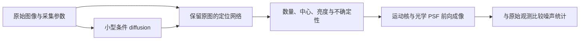

# Diffusion 用于大晶格离子恢复与定位：可行性、数据量与算力评估

日期：2026-11-04（Asia/Hong_Kong）

范围：基于本地 **“Ion Net”** 对话、当前项目源码与数据记录，以及原论文、官方模型资料。本文是方案评估，未训练新模型、未运行 DiT 特征实验；下文的数据规模和硬件配置是**工程规划区间，不是实测结果或收敛保证**。

## 1. 直接结论

**值得做 diffusion，但建议以“小型、物理约束的条件恢复＋离子定位”为主线，以“冻结编辑模型、测试 DiT 局部特征”为低成本探索；现在不建议修改大模型的 VAE 并联合重训。**

你的担心有一部分成立：改变 VAE 的输出表示，可能破坏预训练 DiT 所适应的潜空间分布。但这不等于必须改 encoder，更不等于使用 diffusion 就需要训练十几、几十 B 参数的编辑模型。当前项目已经有一条完全不依赖 VAE 的 diffusion 路线。

| 问题 | 本次判断 |
|---|---|
| micromotion 像高斯噪声，能否直接用 diffusion 去掉？ | 外观上都可能“雾化”，但形成机制不同。micromotion 主要产生曝光积分模糊；必须区分去噪、去模糊和相邻离子解混。 |
| 编辑模型 DiT 特征能否辅助定位？ | 有研究依据，值得冻结模型测试；尚无证据证明其自然图像特征适合本项目的密集、重复、弱亮点源。 |
| 不同离子的 token 有差异，就能直接输出不同位置？ | 不充分。差异可能来自位置编码、背景、亮度或噪声；需要有空间对应关系的局部特征和定位解码器，并验证亚像素中心。 |
| 必须修改 VAE encoder 吗？ | 不需要。先测固定 VAE 的信息损失；优先使用固定特征＋小定位头、原图细节支路，必要时才考虑 adapter/LoRA。 |
| 计划的 1 万张够不够？ | 对专用小模型、冻结特征和有约束的微调，是合理的研究起点；关键在独立晶格、退化覆盖和真值。对改造 12B–20B 基座后联合训练的可靠性，没有足够依据。 |
| 现在应准备多少卡？ | 先用已有 **1 张 6 GiB GPU** 验证现有小模型；正式小模型实验优先 **1 张 24–48 GB GPU**。编辑大模型的原生精度特征实验/LoRA 通常按 **1–2 张 80 GB GPU** 规划，具体取决于基座。 |

推荐资源分配：先把精力投入数据标定、困难样本和可信评测；完成冻结特征实验后，再决定是否租用更大显存。不要先采购多卡服务器来解决尚未确认的表示瓶颈。

## 2. 本地项目实际处于什么阶段

已读取 “Ion Net” 的原始需求、diffusion 讨论、代码构建和后续结果。任务是：PC 上处理单层二维晶格，每帧数百至约 1,000 个离子，定位并画圈；计划采约 10,000 张大晶格图，能重复拍摄，希望尽量避免手工逐点标注，并探索有视觉方法贡献的研究方向。

以下是本地证据，而非对未来实验的假设：

| 项目 | 已核实情况 | 依据 |
|---|---|---|
| 已导入实拍数据 | 931 张 512×512、16 位 PNG，来自 35 个采集目录；另有 13 张 300×800 NPY，总计 944 张 | [已有数据记录](<F:/CQI/Bell Camera/Net Recog/docs/EXISTING_DATA_RUN.md>) |
| 数据划分 | train 426；val 250；test 263；diagnostic 5 | 同上；[导入索引](<F:/CQI/Bell Camera/Net Recog/data/existing_import_manifest.json>) |
| 独立性 | 主要 PNG 来自同次实验；35 个采集目录不能解释成 35 个独立晶格，现有验证也不是跨日期/跨晶格泛化验证 | 同上 |
| 当前 diffusion | 像素空间条件 SmallUNet，base_channels=16 时精确 **137,489 参数**；无 VAE、无 DiT、无自然图像预训练权重 | [模型源码](<F:/CQI/Bell Camera/Net Recog/ionrecog/self_supervised/models.py>)；CPU 实例化计数 |
| 训练目标 | 同组选择一个输入，另外至少两帧平均作目标；默认最多取 8 张目标帧，不包含输入自身 | [训练源码](<F:/CQI/Bell Camera/Net Recog/ionrecog/self_supervised/learning.py>) |
| 当前能力边界 | 目标仍有残余噪声和运动展宽；代码没有自动配准、运动核估计或逐离子定位监督 | 同上 |
| 已有训练证据 | 已有真实数据结果主要针对 masked；diffusion 的流程验证不能当作真实大晶格定位收益 | [方案说明](<F:/CQI/Bell Camera/Net Recog/ionrecog/README.md>) |
| 已有实测提醒 | masked 恢复更平滑曾引入更多背景候选，之后增加原图阈值和晶格区域约束；这说明恢复质量与定位质量不能等同 | [已有数据记录](<F:/CQI/Bell Camera/Net Recog/docs/EXISTING_DATA_RUN.md>)；[区域约束记录](<F:/CQI/Bell Camera/Net Recog/docs/CRYSTAL_REGION.md>) |
| 本机硬件 | NVIDIA RTX 3060 Laptop，6 GiB 显存；已有独立 CUDA 环境 | [环境记录](<F:/CQI/Bell Camera/Net Recog/docs/VLM_TRAINING_ENV.md>)，本次 nvidia-smi 核对 |

因此，**当前最缺的是有代表性的大晶格退化数据及独立参考，而不是先更换 VAE**。已有小晶格数据能检查代码、噪声模型和错误类型，不能单独回答大晶格边缘严重拖尾时能达到什么准确率。

## 3. 关键物理判断：micromotion 不等于像素高斯噪声

### 3.1 三个不同层次

标准 DDPM 的训练加噪通常写为

$$
x_t=\sqrt{\bar\alpha_t}x_0+\sqrt{1-\bar\alpha_t}\epsilon,
\qquad\epsilon\sim\mathcal N(0,I).
$$

这是人为定义的随机训练过程，不能据此推断真实相机或离子的运动服从相同过程。见 [DDPM 原论文](https://arxiv.org/abs/2006.11239)。

离子图像更适合从成像过程表达。令第 i 个离子的投影位置为 c_i(t)，荧光率为 a_i(t)，像素 u 的期望光电子数可简化写为

$$
\lambda_u=b_u+\sum_i\int_0^{T_{\rm exp}}
a_i(t)\,h_u\!\left(c_i(t)\right)\,dt.
$$

这里 h_u 已包含光学 PSF 和像素积分。先形成曝光期间积分的空间分布，再产生光子探测、电子倍增与读出随机性。若继续使用 EMCCD，可用下列层次作为建模起点：

$$
n_u\sim\operatorname{Poisson}(\lambda_u),\qquad
y_u=o_u+g_{\rm ADU}\,\mathcal M_G(n_u)+\eta_{{\rm read},u}.
$$

其中 M_G 表示随机电子倍增，而不只是确定性乘以增益 G；实际还需按标定处理暗电流、CIC、偏置和坏点。因此纯 i.i.d. 加性高斯噪声只是某些条件下的近似。见 [EMCCD 随机模型研究](https://pmc.ncbi.nlm.nih.gov/articles/PMC3561409/)。

| 现象 | 对应问题 | 所需证据 |
|---|---|---|
| 颗粒、随机明暗波动 | 去噪 | 相机标定、独立重复帧 |
| 拉长、环状/双峰、空间变化的光斑 | 去模糊或有效 PSF 估计 | 运动/光学标定、不同退化条件参考 |
| 一颗双峰与两颗重叠难以区分 | 点源数目推断与解混 | 高可信中心参考、多帧或额外测量 |

### 3.2 为什么会“像高斯”，却不能当成高斯噪声

以下是简化物理模型的推导，不是对当前相机的实测拟合。假设一维正弦微运动 x(t)=c+A cos(Ωt+φ)，曝光覆盖很多周期，且荧光率恒定，则位移的时间占据密度为

$$
k(\Delta x)=\frac{1}{\pi\sqrt{A^2-\Delta x^2}},\quad |\Delta x|<A.
$$

它在转折点附近停留较久，**本身不是高斯分布**。与光学 PSF 卷积后，A 较小时可能看起来只是变宽；A 较大时可能出现两端较亮。若光学 PSF 沿该方向的方差为 σ²，则该简化模型的总方差为 σ²+A²/2，但“方差增加”不意味着整个分布成为高斯，更不意味着每个像素独立加噪。

因此，你观察到的雾化直觉有价值，但应把方法问题表述为：**空间变化的运动模糊、相机噪声和点源重叠共同作用下的可靠定位**。拖尾也可能来自离焦、像差或漂移，不能仅凭外观全部归因于 micromotion。

重复平均只能降低随机噪声，不能自动消除上述积分展宽；普通短曝光若仍跨越很多 RF 周期，也不能冻结微运动。相位分辨测量需要相应时间分辨能力或门控设计，已有工作用时间分辨单光子相机直接测量微运动。见 [Zhukas 等，PRA 2021](https://arxiv.org/abs/2010.00159)。

### 3.3 非高斯物理噪声不妨碍使用 diffusion

可行路线是学习 p(x_clean | y, metadata)，或用物理似然约束 p(x_clean | y)，而不是假设 y 就是某个标准扩散时刻的 x_t。扩散模型可以使用人工高斯加噪训练，同时以含 Poisson/倍增噪声和运动模糊的真实观测为条件。DPS 已研究不同观测噪声和非线性逆问题，但其成功不代表当前离子问题会自动被解决。见 [Diffusion Posterior Sampling](https://arxiv.org/abs/2209.14687)。

首先还要明确 clean 的含义：低噪声但仍有拖尾的图、去运动展宽的光学图、中心热图，是三种不同目标。**用重复平均作训练目标，只能直接支撑第一种。**

## 4. “编辑模型＋DiT token 相似度”方案具体能做什么

### 4.1 语义 token、空间 token 和离子实例不是同一个概念

原始 DiT 在潜空间 patch 上运行 Transformer；token 是图像区域表示，并不是天然的“第 i 个离子”。见 [DiT 原论文](https://arxiv.org/abs/2212.09748)。

编辑模型的结构也不同。以**原版 Qwen-Image-Edit**为例，官方说明输入图像同时进入 Qwen2.5-VL 获取语义控制信息、进入 VAE 获取外观表示，基于 20B 图像生成模型；FLUX.1-Kontext-dev 则是 12B 的 rectified-flow Transformer。本文以这两个已核实版本举例，不把所有编辑模型都视为同一种 DDPM。见 [Qwen 官方模型卡](https://huggingface.co/Qwen/Qwen-Image-Edit)、[FLUX 官方模型卡](https://huggingface.co/black-forest-labs/FLUX.1-Kontext-dev)。

对当前任务，应优先读取**保留二维坐标映射的图像中间特征**，而不是只比较整张图的 pooled embedding 或文本条件。“这张图含离子”与“每颗离子的中心在哪里”是不同能力。

### 4.2 有依据，但现有依据不等于离子任务已成立

DIFT 表明预训练扩散网络的中间特征可用于真实图像的语义、几何和时间对应；其官方实现主要基于 Stable Diffusion/ADM 等网络。它支持“冻结扩散模型做特征实验”的思路，**不能直接证明任意编辑式 DiT 能区分 1,000 个近乎相同的离子**。DIFT 与 DiT 也不是同义词。见 [DIFT 论文](https://arxiv.org/abs/2306.03881)、[官方实现](https://github.com/Tsingularity/dift)。

更直接的先例是 **DiTF（NeurIPS 2025）**：研究发现部分 DiT 特征中的少数大激活通道会压过局部信息，导致直接余弦匹配退化；通过 AdaLN 通道调制和通道剔除，可在不训练基座的情况下改善对应特征。因此，第一次直接比较 raw token 失败，不能立即归因于 VAE 或训练数据不足；应先比较特征提取和后处理方式。该方法仍未验证本项目的离子图像，也不能假设不同编辑架构具有完全相同的激活问题。见 [DiTF 原论文](https://arxiv.org/abs/2505.18584)。

最容易出现的三种结果是：

1. 特征能分开“离子”和“背景”，适合作候选区域或前景特征。
2. 特征能表示亮度、拖尾方向和邻域结构，辅助检测头判断一个还是多个中心。
3. 相邻离子的局部外观非常相似，匹配矩阵出现多个相近峰，不能仅靠相似度决定实例归属。

第三种情况在重复晶格里尤其需要检验。**检测并不要求每颗离子有独特语义身份**；可以让所有离子属于一个类别，通过空间热图或点集合输出多个位置。跨帧持续跟踪“同一个离子”还需要运动约束、参考配准和身份规则；对完全对称、观测不可区分的对象，模型不能创造身份信息。

### 4.3 建议的冻结特征实验

先收集 50–200 个有可靠中心或对应关系的图像组，包含清晰/拖尾/弱亮/重叠/缺陷。这里指图像组，不是同一晶格随意取 200 张连拍。

**实验分为四步：**

1. **先测 VAE 往返。**固定预处理后做 D(E(y))，测弱点是否消失、两点是否合并、中心是否偏移；用真实图和具有精确中心的合成点对共同检查。往返失败说明生成通路值得警惕，但不严格证明潜变量完全不含该信息，后续小解码头实验仍有必要。
2. **提取局部特征。**选择少量浅/中/深层和低/中/高噪声水平，对输入图编码并按该模型的训练参数化构造状态，保存空间对应。编辑模型的参考图 token 与待生成 token 分开记录。首轮不要把完整编辑后的生成图作为特征真值。
3. **测试相似度及小定位头。**比较原始特征的余弦匹配、通道标准化，以及在兼容架构上的 DiTF 式调制/通道处理；单纯 L2 单位化不改变余弦相似度，不能解决少数通道支配的问题。有对应参考时进行配准、局部搜索、一对一匹配。再训练一个很小的热图＋亚像素偏移头，检验冻结特征能提供多少定位信息。参考图如果在推理时不可获得，不能偷偷作为模型输入。
4. **做反证对照。**改变噪声种子、整体平移、亮度、局部遮挡和离子缺失；比较原始强度/PSF模板、随机初始化特征、常规视觉特征与 diffusion 特征。层和时间步只在验证集选择。

应检查同一位置的特征是否只是记住绝对坐标。整体平移后正确中心应随图像移动；删除离子后，模型不能因为晶格模板仍输出该点。不同重复帧的同一离子应稳定，而相邻离子是否可分应在配准后的困难样本上报告。

第一轮只需要前向提特征，不需要先微调 VAE，也通常不需要执行完整多步生成。对选出的特征可缓存，但不要一开始缓存全部层、时间步和种子。

### 4.4 空间压缩是需要早测的风险

若某模型的 VAE 空间缩小 f 倍，DiT 再按 p×p 潜变量成 token，则输入坐标中的名义 token 间距为 s=fp。例如 **f=8、p=2** 时，送入编码器的 512×512 图只有 32×32=1,024 个空间格点，每格对应输入 16×16 像素。原版 Qwen-Image-Edit 的官方 Diffusers 流水线也明确采用空间压缩 8 倍及 2×2 latent 打包；实际原图尺度还取决于预处理缩放，编辑时参考图、目标图和文本 token 的总序列长度需另计。见 [官方流水线源码](https://raw.githubusercontent.com/huggingface/diffusers/main/src/diffusers/pipelines/qwenimage/pipeline_qwenimage_edit.py)。

这不是所有模型的统一配置。通道可以编码亚格点信息，网络可以预测多个实例，所以不能简单断言“一个 token 最多一个离子”；但对于数像素宽、邻近密集的光斑，压缩和预处理确实可能丢失关键细节。应根据实际光斑 FWHM、最近邻间距、边缘拖尾长度和目标定位误差来验证。

应保持原始 16 位强度的可追溯映射，先裁剪有效区域再按模型要求输入；灰度复制到 RGB 不会增加物理信息。插值放大可改变 token 覆盖尺度，但不会创造新细节。缩放、padding、tile 原点、半像素约定都要记录并反变换，否则漂亮的热图也可能产生系统性坐标偏差。

## 5. VAE 与 DiT 的耦合：担心正确，但不必从最难的地方开始

潜扩散常先训练图像自编码器，再在固定的潜表示上训练生成模型，因此它们是**表示分布和接口上的耦合**，不意味着必须端到端联合训练。见 [Latent Diffusion 原论文](https://arxiv.org/abs/2112.10752)。

大幅修改 VAE encoder 会改变潜变量尺度、通道统计和空间编码；仅保持张量形状相同，并不能保证旧 DiT 仍适用。若 encoder/decoder 失配，重建也会受影响。为了看清细点而改下采样率，还会增加 token 数与注意力成本。

建议按以下顺序升级：

| 方案 | 训练部分 | 对现有表示的影响 | 优先级 |
|---|---|---|---|
| 冻结 VAE 和 DiT＋小定位头 | 热图、偏移、置信度头 | 不改变生成潜空间 | 首先试 |
| 冻结大模型＋原图高分辨率支路 | 小 CNN/融合头 | 用原图补局部证据 | 优先于改 VAE |
| 条件 adapter 或 DiT LoRA | 少量新增/低秩参数 | 有限适配，仍需反传及泛化评测 | 特征实验显示潜力后 |
| 小型像素空间 diffusion | 自建小 U-Net/小 Transformer | 无预训练 VAE 兼容问题 | 推荐主线 |
| 微调 VAE 并对齐旧潜空间 | encoder/decoder、对齐模块，必要时 DiT | 可能破坏兼容性；需重建和定位共同约束 | 仅在证实压缩为主瓶颈后 |
| 大幅重构 VAE＋全量 DiT 训练 | 大部分或全部基座 | 数据、优化与算力成本最高 | 当前不推荐 |

LoRA 降低可训练参数和优化器状态，不会把整个基座的存储、前向计算及训练激活消掉。见 [Diffusers 官方 LoRA 文档](https://huggingface.co/docs/diffusers/training/lora)。

## 6. 更适合当前项目的主线

建议把最终输出定义为每颗离子的**平均/平衡位置估计、检出概率和定位不确定性**；圆圈是显示方式。是否恢复到平衡位置，需要参考测量支撑，不能直接把最亮像素当作该真值。

训练应分两级推进：

- **先验证去噪：**稳定重复帧提供低噪声参考，对比普通回归 U-Net、masked/Noise2Noise 和条件 diffusion。Noise2Noise 依赖同一潜在信号及相应噪声期望/独立性条件，其结论不能不加修改地套到任意 diffusion 训练上。见 [Noise2Noise](https://proceedings.mlr.press/v80/lehtinen18a.html)。
- **再研究去模糊＋定位：**用校准后的物理模拟产生中心、运动幅度/方向和相机噪声真值，结合真实参考或物理似然训练。加入缺陷、非规则边界、弱离子及非理想晶格，避免学成“补齐晶格”。

一个候选联合目标是扩散损失＋可信中心监督＋原图观测负对数似然。没有可信中心的样本不能硬加伪精确标签；成像模型不充分时，一致性也不能证明答案唯一。恢复结果与原图不必逐像素相等，残差应与所采用的噪声模型相容。

推理时可对困难区域采样多次，比较位置分布；**不要直接平均多种不同离子数或不同中心的图像**，否则可能再次制造模糊或虚假中间峰。先匹配点集合，再统计不确定性；采样一致性仍需独立参考校准。

若条件 diffusion 只让图像好看，却不能减少漏检、误检或定位偏差，应保留更快的直接定位模型。若多种解都符合观测，应输出不确定或申请额外参考，不能把生成先验当作新增测量信息。

## 7. 数据集需要多大

### 7.1 先区分四种“数据量”

必须同时报告：**独立晶格/重装载数、条件组数、原始帧数、抽样 patch 数**。一万个连拍帧或一百万个裁剪块不等于同样数量的独立场景。每帧 1,000 个离子也不能直接算成 1,000 张独立训练图。

没有适用于这个问题的已验证样本量公式。下表是针对当前任务的起步规划，真实需求要用按组留出的学习曲线决定。

| 路线 | 建议起步数据 | 更完整的研究规模 | 判断 |
|---|---|---|---|
| 冻结 diffusion/DiT 特征探测 | 50–200 个有参考的图像组，覆盖主要失败类型 | 扩展至独立大晶格测试集 | 无需先采海量训练数据 |
| 小定位头/小型直接定位网络 | 200–1,000 张可用参考/点标注图，或物理合成预训练＋少量真实标定 | 2,000–10,000 张真实帧、100–300 个独立构型量级 | 通常比改大基座更适合当前阶段 |
| 小型条件 diffusion | 先用 300–800 张稳定重复帧检验去噪 | 2,000–10,000 张真实帧＋10万–100万个按需生成的物理合成 patch | 1 万张是合理预算，但需正确目标和分布覆盖 |
| 冻结 VAE＋编辑 DiT LoRA/adapter | 可先以 1,000–3,000 个可信训练对做验证 | 5,000–20,000 个有明确目标的训练对作为预算区间 | 是适配实验，不是保证所需最小值；重复帧配对不能当独立数据 |
| 改 VAE＋12B–20B 基座大范围训练 | 当前不值得按一个“最低张数”承诺 | 若立项，按 5万–20万张跨构型/成像条件的校准图、更多合成样本预留采集成本，再由学习曲线调整 | 这是成本情景，绝非“达到就够”；1 万张不能支持成功承诺 |

小模型不必从自然图像模型的规模推算数据需求。对于专用点源任务，物理模拟能提供大量精确中心；但模拟必须在**未参与校准的真实采集组**上验证，否则只是拟合一个自洽模拟器。

### 7.2 对“采 1 万张”的具体建议

可采用下列**示例设计**，把 1 万张解释为样本原始帧总量：

$$
200\ \text{独立晶格构型}
\times5\ \text{成像/退化条件组}
\times10\ \text{稳定重复帧}
=10,000\ \text{帧}.
$$

200 个构型应来自实际重装载/重排或有明确独立性的准备过程，并尽量跨 10–20 个采集日期/会话；不要把同一晶格改变曝光就计作新的独立构型。5 个条件不是固定必需值，应结合初期错误分析安排，重点覆盖密度、边缘展宽、SNR、焦点、背景和缺陷。

同一个构型谱系的所有条件、重复帧、裁剪和增强都留在同一 split。例如按构型 140/30/30 分 train/val/test，对应约 7,000/1,500/1,500 帧；再确保测试包含整次留出的日期和较严重退化。**测试中 1,500 帧仍只有约 30 个构型簇，统计时不能按 1,500 个独立场景计算置信区间。**

在每组 10 帧中，单帧输入的参考可由其余 9 帧组成；必须先验证位置、亮暗状态和强度稳定，排除重排/漂移/状态变化。当前代码默认最多用其中 8 张，不做配准，这与理论设计仍有差距。

如果你所说的“1 万张”是 **1 万个不同条件输入，每个还要额外 9 张重复参考**，实际采集将接近 10 万帧，而不是 1 万帧。参考获取方案需要在采集前固定。

### 7.3 不想大量人工标注，仍然需要哪些参考

可以免去训练集全量人工标注，但不能免去可信测试集：

- 物理合成提供精确中心和退化参数，适合预训练及受控反例。
- 稳定重复平均提供低噪声参考，适合去噪；**不提供无 micromotion 模糊真值**。
- 少量同步/相位分辨或其他独立标定、可靠清晰参考，支持实际中心。改变补偿或阱参数可能移动晶格，必须校准映射，不能默认前后中心完全一致。
- 首轮安排 **50–100 张独立代表帧＋300–500 个困难局部区域**做参考建立和人工复核；这些可相互重叠，不是额外独立样本。若要严格报告整帧全正确率，需要完整可信标注的整帧；只有局部标签时只能报告局部指标。
- 不可判定区域保留位置区间/不确定标签，不能由被比较的方法自己给自己做真值。空场、真缺陷和弱亮点应进入盲测。

暗场、偏置、增益/光子转移、不同视场位置的孤立点源/PSF 标定应另行留预算，不计入上面的 10,000 张样本帧。每个主要相机模式可先准备几十至几百帧相应标定数据，再看统计稳定性补充；具体次数取决于标定项目。

## 8. 训练到底要多少张 GPU

### 8.1 可执行的配置分级

下表按单通道科学图像、以 128–256 像素 patch 训练小模型、以约 512 像素输入测试编辑模型估算。默认混合精度、小 microbatch、必要的激活检查点；大模型冻结的条件编码器尽量预计算/卸载。**未经当前工作负载实测，不能把任何一行理解为必定能装入显存。**

| 实验 | 训练规模/方式 | 起步或紧凑配置 | 较稳妥的研究配置 |
|---|---|---|---|
| 现有 diffusion 原型 | 0.137M 参数，64–128 patch，batch 1–4 | 本机 **1×6 GiB**，需有空闲显存；CPU 可做冒烟验证 | 不必买新卡 |
| 专用像素 diffusion＋定位 | 约 5M–30M 参数，128–256 patch，microbatch 1–8 | **1×24 GB** | **1×48 GB**，或 2×24 GB 增加吞吐；更大模型需另测 |
| 较小预训练扩散网络冻结特征 | 不反传基座，仅训练小头 | **1×16–24 GB**，视模型及提取层而定 | **1×24–48 GB** |
| FLUX.1-Kontext-dev 12B 冻结探测 | 仅前向；条件预计算 | **1×48 GB** 原生半精度、小 batch | **1×80 GB**；24 GB 仅考虑量化/卸载方案 |
| Qwen-Image-Edit 20B 冻结探测 | 仅前向；VL/VAE 分阶段运行 | **1×80 GB** 作为规划起点 | **1×80 GB**；较小卡需量化/卸载并重新检查特征质量 |
| 12B DiT LoRA | 冻结 VAE/条件编码器，低秩参数训练 | **1×48 GB** 属紧凑尝试 | **1×80 GB**，必要时 2×80 GB |
| 20B DiT LoRA | 冻结 VAE/条件编码器，检查点/小 batch | **1×80 GB** 属需 profiler 验证的起点 | **2×80 GB**，使用合适分片而不是默认 DDP |
| 12B DiT 全参数微调 | Adam 类优化器，模型/状态分片 | **4×80 GB** 作为估算起点 | 4–8×80 GB，视分辨率和激活而定 |
| 20B DiT 全参数，或 VAE 联合适配 | 分片优化器、梯度和参数 | **8×80 GB** 级别规划 | 8 张及以上；同时训练大型 VL encoder 还要上调 |

如果采用 4-bit/8-bit 冻结权重和 CPU offload，部分大模型实验可在 24–48 GB 上尝试，但是否支持该模型的反向路径、速度和特征误差都要验证。**能低显存生成一张图，不代表能训练，也不代表量化后的定位特征精度足够。**

对你的实际决策：先用现有 6 GiB 跑小模型 pilot；需要扩大实验时，优先租 1 张 24–48 GB。只有冻结编辑模型特征显示明确收益，才升级到 80 GB。这里没有必要直接起步 8 卡。

### 8.2 估算依据：参数显存与激活显存

以十进制 GB 粗算，仅 BF16 权重需要 2P 字节：12B 约 **24 GB**，20B 约 **40 GB**；尚不含条件编码器、VAE、激活和算子工作区。

采用 BF16 参数/梯度、FP32 主权重及两个 FP32 Adam 动量的常见混合精度配置时，模型状态约为

$$
M_{\rm state}\approx(2+2+4+4+4)P=16P\ \text{bytes}.
$$

由此 12B 约 **192 GB**、20B 约 **320 GB**，仍未包括激活、临时 buffer、额外编码器和其他模型副本。不同优化器/框架不一定保留全部这些副本，数字用于量级解释；不能简单除以单卡显存后就宣称训练一定可行。

多卡 DDP 通常复制模型，**两张 24 GB 不会自动变成一张可用的 48 GB 卡**；大模型需 FSDP/ZeRO 等适当分片。梯度累积能扩大有效 batch，不能解决单个 microbatch 本身放不下的问题。

### 8.3 训练时间、GPU 小时与多次实验

缺少确定模型、batch、分辨率和实测每步时间时，不能可靠给出“训练几天”。建议用优化步数规划，然后先做 200–500 步计时：

| 阶段 | 首轮预算建议 | 扩展条件 |
|---|---|---|
| 冻结特征 | 50–200 组；少量层/噪声水平；先 1 个种子，再对候选组合测 4 个种子 | 有稳定空间信息再扩充 |
| 小型 diffusion | 2万–10万优化步；先较小 patch 验证 | 独立验证持续改善再增加步数/模型 |
| 小定位头或 LoRA | 小头可先 5千–2万步；LoRA 可先 2千–1万步 | 以真实独立验证收益决定，防止重复配对过拟合 |

$$
T_{\rm wall}=\frac{S\,t_{\rm step}}{3600}+T_{\rm val}+T_{\rm I/O},
\qquad
H_{\rm GPU}=N_{\rm GPU}\,T_{\rm wall}.
$$

举例：**假设**小模型单卡 50,000 步、每步 0.5–2 秒，则纯训练约 6.9–27.8 小时；另留约 30% 给验证/保存，则约 9–36 GPU 小时。**假设**LoRA 在 2 卡上 10,000 步、每步 3–10 秒，则纯训练约 8.3–27.8 小时、16.7–55.6 GPU 小时。这些只是代入示例，不是本机/特定 GPU 的吞吐测量。

完整研究还需多个种子、基线和消融。小模型阶段可以先批准 **50–100 GPU 小时的试验预算**，看到收益后再按实测速率规划几百 GPU 小时的比较实验；不应一次性预定大规模联合训练。

训练随机采一个时间步计算扩散损失，不等于每次训练都执行全部采样步。推理则不同：当前默认 20 次反向采样，再乘 tile 数和重复样本数。对于 512×512、tile=256、overlap=32，现有实现会形成 3×3 个 tile，即每个恢复样本约 180 次 tile 网络前向；重复 K 次约再乘 K。正式报告应测整帧耗时，而非只报单 patch 时间。

### 8.4 磁盘和内存也需要预算

本次检查 F 盘可用约 **24.65 GiB**，这是随其他工作变化的快照。当前空间不适合直接再放一个完整半精度 20B 编辑模型及其所有依赖/训练状态。

- 10,000 张 512×512 uint16 未压缩原始数组约 **4.88 GiB**；float32 参考再约 9.77 GiB。若总帧数是 100,000，则 uint16 原始数组约 48.8 GiB，均未计备份、元数据和中间输出。
- 示例：每图缓存一个 32×32×3,072 的 FP16 特征约 **6 MiB**，10,000 张约 58.6 GiB；多个层、时间步、种子会继续相乘。这是缓存设计示例，不表示当前模型一定输出此尺寸。
- 小模型实验建议另备 100–200 GB 可用空间；大编辑模型/多层特征实验预留 200–500 GB 更方便。采用按需合成、有限 checkpoint、只缓存选中层，避免把训练块全部复制到磁盘。
- CPU offload 会增加主存和传输负担；大型编辑模型实验可按 64–128 GB 系统内存作规划，再按所选流水线测量。

## 9. 哪些实验能真正决定可行性

### 9.1 公平比较

保留共同数据划分、相同输入信息和相同测试标签，至少比较：

1. 原图＋现有经典定位/PSF 联合拟合。
2. 原图＋小型中心热图/点集合模型。
3. 普通去噪 U-Net＋同一定位器。
4. 条件 diffusion＋同一定位器。
5. 原图与 diffusion 结果联合定位。
6. 冻结 diffusion/DiT 特征＋小定位头；有收益后再加 LoRA。

先固定定位器看恢复模块的独立贡献，再允许各路线分别充分训练。多帧、参考图或额外标定输入的方案另列，不能与只用单帧的方案混为相同条件。加入 DECODE 类密集荧光定位基线，有助于避免只赢过较弱通用检测器。见 [DECODE 原论文](https://pmc.ncbi.nlm.nih.gov/articles/PMC7611669/)。

### 9.2 主要指标

用预先规定距离阈值的一对一匹配报告 precision/recall、漏检/多检、定位误差中位数和 P95、合并/分裂错误、真实边界外误检、整帧全正确率，以及 GPU 峰值显存和整帧耗时。定位误差要与漏检率一起看，不能只统计成功检出的容易离子。

按边缘/中心、SNR、拖尾长度、离子间距、晶格规模和采集日期分层。距离容差应由控制/读出需求及标签精度决定，可同时给多阈值曲线。以独立晶格/会话为单位给置信区间；同一晶格的重复帧不能当独立样本扩大显著性。

PSNR/SSIM、特征聚类图和余弦相似度热图只作辅助。晶格区域内全是候选不代表全是离子；估计边界外候选为零也不代表边缘召回正确。暗态与缺失仅凭无荧光图通常不能区分，需要已知位点/参考或独立实验协议。

### 9.3 建议的继续/停止门槛

这些是可预注册的工程门槛示例，不是通用标准：

- VAE 往返和冻结特征实验若已使弱点大量消失、相邻点混叠，且小解码头也无收益，优先回到高分辨率/像素路线，不直接扩大 LoRA。
- 假定应用允许 0.5 像素总误差，可先为编码压缩分配约 0.1 像素附加偏差预算；实际阈值应由光学标定和控制需求替换，不能为了某模型通过而事后调宽。
- 在预先固定的困难子集上，要求相同误检约束下漏检/合并错误有稳定下降，且没有明显中心偏移或缺陷补点；例如把相对错误下降 10%–20% 作为值得扩展的目标，再用置信区间判断证据强度。
- 如果普通 U-Net/直接定位以更低成本取得同等结果，就不把 diffusion 设为必要组件。
- 改 VAE 只有在“固定编码是主要瓶颈”得到证据后才立项；训练失败不应一律归因于数据不足。

## 10. 与已有研究的关系及建议推进顺序

显微图像条件扩散恢复已有 [WACV 2025 工作](https://arxiv.org/abs/2409.12078)，3D 荧光去噪/超分辨已有 [Volume Tells，CVPR 2025](https://arxiv.org/abs/2503.02261)。离子阵列运动校正与神经网络定位也有 [Wolf 等工作](https://arxiv.org/abs/2303.10801)，但其 Penning 阱旋转与本项目假设的 Paul 阱 micromotion 不同。**这些支持方法可探索，不支持“加 diffusion 就是新方法”或论文录用保证。**

更有价值的研究问题是：在密集重复点源、空间变化的运动积分核和非高斯探测噪声下，如何可靠区分一个展宽离子与多个重叠离子，并在不可辨识时给出校准的不确定性。创新需要靠独立参考、困难反例和强基线证实，本文没有做穷尽式新颖性检索。

建议依次执行：

| 阶段 | 产出 | 决策 |
|---|---|---|
| A：先补小批数据 | 300–800 帧大晶格 pilot、稳定重复组、标定和少量可信中心；明确光斑大小/间距/运动强度 | 确认主要失败来自噪声、展宽还是解混 |
| B：并行做两项便宜验证 | 当前小模型恢复＋定位基线；50–200 组固定 VAE/扩散特征探测 | 决定是否需要大模型特征及更大显存 |
| C：投入主要实验 | 约 1 万帧按组采集；物理合成预训练；真实参考校准；原图支路与联合定位 | 验证跨晶格、跨条件收益 |
| D：证据支持才升级 | LoRA/adapter，或面向困难区域的后验采样 | 只有可重复优势才增加算力 |
| E：最后才考虑 | VAE 结构修改与大基座联合训练 | 需要明确的信息损失证据和独立资源立项 |

**本项目当前最合适的选择是：保留现有像素 diffusion 作为起点，先修正目标与物理退化建模；另开一组冻结特征实验检验你的 DiT 想法。1 万张有组织的数据＋1 张 24–48 GB GPU 足以支持有意义的小模型研究，不必预设从 8 卡大模型训练起步。**

## 11. 主要来源与证据边界

以下为本次用于判断的原论文或官方资料，同一工作的 arXiv/会议/代码版本不作为多项独立证据。链接已通过网页检索或读取核查；部分出版社 HTML 访问失败时使用原论文公开版本。模型以文中指定版本为准，不声称覆盖所有最新编辑模型。

| 来源 | 支撑内容 | 不支撑的外推 |
|---|---|---|
| [Ho 等，DDPM，2020](https://arxiv.org/abs/2006.11239) | 扩散训练加噪形式 | 离子退化等于高斯像素噪声 |
| [Hirsch 等，EMCCD stochastic model，2013](https://pmc.ncbi.nlm.nih.gov/articles/PMC3561409/) | 探测、倍增与读出噪声建模 | 已标定本项目所有噪声参数 |
| [Zhukas 等，PRA 2021](https://arxiv.org/abs/2010.00159) | 时间分辨微运动测量 | 单张普通长曝光恢复完整相位 |
| [Rombach 等，LDM，CVPR 2022](https://arxiv.org/abs/2112.10752) | 潜空间生成与预训练自编码器 | 改 encoder 后旧 DiT 自动兼容 |
| [Peebles 与 Xie，DiT，ICCV 2023](https://arxiv.org/abs/2212.09748) | 潜变量 patch Transformer | 一个 token 就对应一颗离子 |
| [Tang 等，DIFT，NeurIPS 2023](https://arxiv.org/abs/2306.03881) | 扩散中间特征的对应能力 | 对密集同种离子已验证 |
| [Gan 等，DiTF，NeurIPS 2025](https://arxiv.org/abs/2505.18584) | 大激活通道问题、无需训练的 DiT 对应特征提取 | 任意编辑模型的原始 token 都直接适合离子匹配 |
| [Chung 等，DPS，ICLR 2023](https://arxiv.org/abs/2209.14687) | 噪声逆问题与近似后验采样 | 当前物理模型正确、后验必定校准 |
| [Lehtinen 等，Noise2Noise，ICML 2018](https://proceedings.mlr.press/v80/lehtinen18a.html) | 有条件的带噪对训练 | 重复平均能去运动模糊 |
| [Qwen-Image-Edit 官方卡](https://huggingface.co/Qwen/Qwen-Image-Edit)、[技术报告](https://arxiv.org/abs/2508.02324) | 原版 20B 与语义/外观输入支路 | 本文显存/耗时已由官方测量 |
| [FLUX.1-Kontext-dev 官方卡](https://huggingface.co/black-forest-labs/FLUX.1-Kontext-dev) | 12B rectified-flow 编辑模型 | 可直接套用 DDPM 的全部实现细节 |
| [Diffusers LoRA 文档](https://huggingface.co/docs/diffusers/training/lora) | 参数高效适配机制 | 低显存推理等同于低显存训练 |
| [Osuna-Vargas 等，WACV 2025](https://arxiv.org/abs/2409.12078)；[Li 等，Volume Tells，CVPR 2025](https://arxiv.org/abs/2503.02261) | 显微图像扩散恢复先例 | 本项目去噪后定位一定更准 |
| [DECODE，Nature Methods 2021](https://pmc.ncbi.nlm.nih.gov/articles/PMC7611669/)；[Wolf 等，离子成像](https://arxiv.org/abs/2303.10801) | 密集点源定位、相关离子任务基线 | 同一物理条件与同一输入信息 |

尚待实测的关键量：大晶格光斑 FWHM/间距、运动幅度与方向分布、噪声参数、真实参考可得性、应用允许的坐标误差、指定编辑模型的空间特征质量、GPU 每步时间/峰值显存。它们决定最终的数据和算力需求；本文所有采集数量、卡数与时间预算均需在 pilot 后更新。
